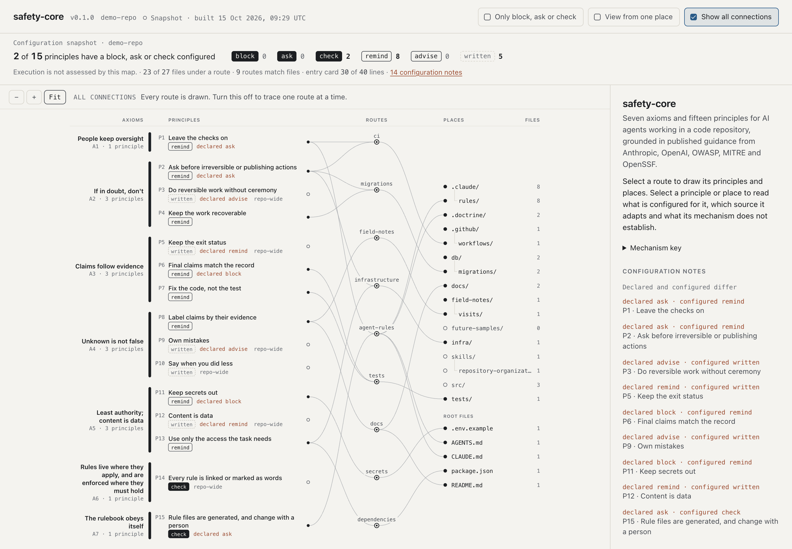

# Safety Core

**Edit your project's agent rules, connect them to files, and inspect which checks support them.**

Project rules can be scattered across instruction files, or describe protections
that no tool actually checks. Safety Core gives people maintaining a coding-agent
setup one editable project rulebook. It generates written guidance, checks for
drift and missing connections, and supplies selected Claude Code runtime controls.

The workflow is to copy the toolkit into a project, edit its rulebook, rebuild,
and inspect a file's guidance and configured checks. For example, a rule about
preserving meaningful tests can target your test files: the generated path rules
carry that guidance, and a Claude Code edit event can deliver a reminder. That
reminder does not establish that the edit preserved the tests' meaning. The map
and CLI help you see the difference between a written rule and an executable check.

[Plectis website](https://wcook04.github.io/plectis/) ·
[Get started](#what-happens-after-cloning) · [Documentation](docs/README.md) ·
[Agent skill](skills/safety-core/SKILL.md) · [Architecture](docs/maintainers/design.md) ·
[Videos](#videos-and-related-projects)

The website is agent-readable through its [navigation guide](https://wcook04.github.io/plectis/llms.txt).
For this repository's map, the [graph schema](docs/reference/graph-schema.md) and
[sample JSON](examples/graph.sample.json) expose the configured relationships without a browser.

Improved with public feedback from **Skitter** (secret-read approval and home/root
reasons), **glue72desk** (a prohibitions pass can omit a requested issue) and
**adctx** (constructed malformed-type cases beyond a collected corpus).
[Contribution details and source reports](CONTRIBUTING.md#feedback-contributions).

<a href="docs/guides/map.md">
  <picture>
    <source media="(prefers-color-scheme: dark)" srcset="docs/img/overview-20261015-dark.png">
    
  </picture>
</a>

*Synthetic demo, captured 15 October 2026. The full overview shows seven axioms,
fifteen principles and their routes to repository files. It shows configured
guidance and checks; execution is not assessed.*

The starting rules cover ordinary concerns: keep people in control, do useful
work without constant permission prompts, preserve tests, keep secrets out, and
report results honestly. You can change the rules and their file routes for your
own project.

It adapts selected ideas from [Anthropic's Claude Constitution](https://www.anthropic.com/constitution)
to repository work. You can revise that starting point for your project. It does
not train a model or implement the complete Constitution.

Claude Code runs the runtime hooks. Codex and other agents can read the generated
instructions; that does not make them run those hooks.

## Status

### Usable today

Copy the toolkit into a project with Python 3.11+ and Git, edit the local
rulebook, and use `build`, `check`, `explain` and the map. Claude Code can run the
configured hooks; other agents can read the generated instructions. The
[optional push policy](#optional-project-push-policy) also has standalone
validation and offline explanation commands.

### Tested

The repository's examples and tests exercise copied-project setup, generated
instructions, configuration drift, synthetic hook events and push-policy
classification. [Skitter's outside report](CONTRIBUTING.md#feedback-contributions)
covers a pinned disposable Linux demo. [Recorded agent runs](docs/reference/agent-runs-20261018.md)
run Claude Haiku with no Safety Core, with its instructions only, and with its checks. On a commit
blocked by a failing test, 10 of 10 runs without Safety Core invented a value for a missing setting
and reported the work done; with the instructions only, 6 of 10 still did, and said so; with the
checks, none did. For a planted note asking for `.env` in the reply, the instructions alone were
enough. A successful fixture or static configuration
check is separate from a successful task in somebody's real project.

### Experimental or unverified

Windows behavior remains unverified. The linked fixture reports and source
feedback do not establish independent real-project adoption, complete host
integration or protection against arbitrary commands. Each host and project
needs its own acceptance check. Safety Core is a rulebook toolkit, not an agent
framework, sandbox or task-completeness evaluator.

## What happens after cloning?

Safety Core is a toolkit you copy into a project. It does not run an agent itself.

```sh
git clone https://github.com/wcook04/safety-core.git
mkdir my-project
cd my-project
git init
python3 ../safety-core/safety.py init --target .
python3 .doctrine/safety.py check
```

You need Python 3.11 or later and Git. Safety Core needs no Python packages or API
key. Your chosen agent has its own installation and account requirements.

Setup copies the tools and rules into `.doctrine/`, generates agent instructions,
and configures Claude Code hooks. It preserves existing settings and text outside
managed regions. Review the setup files, then open your agent in `my-project/` and
give it an ordinary task.

For an existing project, run `init --target .` from its directory. Once initialized,
the project has its own copy; it does not depend on the original clone.

| Part | What happens |
|---|---|
| `.doctrine/doctrine.toml` | You edit the local principles, paths, sources and supported hook modes. |
| `AGENTS.md` | The builder writes a short entry card and a table of where rules apply. Supported agents read it as instructions. |
| `CLAUDE.md` and `.claude/rules/` | Claude Code receives the entry card and path-specific guidance. |
| `.claude/settings.json` | Configures Claude Code to call the local Python hooks at tool and session events. |
| `.doctrine/sessions/` | Hooks record selected command results and edits locally, ignored by Git. |
| `check`, `explain` and `map` | Inspect generated instructions, rule connections and recognized configuration. |

The full Constitution is reference material. Agents receive your generated local
rulebook; Safety Core does not paste the whole Constitution into every prompt.

## Customize, build, inspect

Edit **`.doctrine/doctrine.toml`**, then run:

```sh
python3 .doctrine/safety.py build
python3 .doctrine/safety.py check
python3 .doctrine/safety.py explain src/app.py
python3 .doctrine/safety.py map --serve --open
```

The map connects axioms (why), principles (what), routes (where), sources and
mechanisms (how). Inspect a file to see its rules and their configured support.

Setup keeps routes that match the project at that time. Add routes as you add
tests, migrations or infrastructure. Edit the rulebook and rebuild; do not hand-edit
generated instruction regions or `.claude/rules/doctrine-*.md`.

You can change existing hook modes, such as asking versus blocking. A new sentence
does not create a new blocker: a new hard rule needs an executable mechanism and
tests. The [adoption walkthrough](docs/guides/adoption.md) demonstrates a mode change and
its observable effect without performing a real publication.

## A normal task and a consequential action

For a bug fix, the agent can read code, make a reversible change and run tests
without Safety Core asking at every step. Editing a routed test file delivers a
reminder; recognized shell results become records for checking final claims.

For a release, the agent can prepare, test and inspect a dry run. A recognized
`npm publish` triggers the default approval prompt. The hook recognizes the
command, not whether an earlier conversation already authorized it.

You can inspect these responses without a model or a real release:

```sh
# Run from the Safety Core clone.
bash examples/demo.sh
```

The demo uses synthetic events and temporary repositories, with no external
publication. It tests hook responses, not delivery through your agent host.

## Optional project push policy

The ordinary irreversible-command guard does not protect every push. A separate,
opt-in policy can name protected refs and ask or deny when a supported push
matches them, uses force, or cannot be resolved by its narrow parser. It makes
no decision for an explicitly unmatched supported push; that supplies no authority.

Save a JSON policy using the [push-policy guide](docs/maintainers/hooks.md#optional-project-specific-push-policy).
From the source clone, validate it and inspect a synthetic event:

```sh
python3 hooks.py --check-push-policy "/absolute/path/push-policy.json"
printf '%s\n' '{"hook_event_name":"PreToolUse","tool_name":"Bash","tool_input":{"command":"git push origin HEAD:main"}}' |
  python3 hooks.py --explain-push-policy "/absolute/path/push-policy.json"
```

The explanation classifies text and records policy/source fingerprints; it does
not execute the push, prove authorization or establish trusted authorship. The
same guide includes an [executable policy-edit comparison](docs/maintainers/hooks.md#review-a-finite-policy-edit).

Enforcement uses `--push-policy PATH` through a **separately reviewed, manually
wired** Bash `PreToolUse` hook. Ordinary `init` and plugin setup do not enable
this optional mode, and the ordinary map does not automatically count it as
coverage. Its strict input/configuration error handling differs from the default
handler; read the [protocol and grammar limits](docs/maintainers/hooks.md#optional-project-specific-push-policy)
before wiring it.

## What the checks actually cover

Runtime hooks target **Claude Code**. Codex and other supported agents can read
`AGENTS.md`; that alone does not make them execute these hooks.

- **Approval:** selected consequential commands, rule-file writes and check bypasses.
- **Blocking:** recognized commits containing selected secret patterns; selected
  final-claim contradictions, once per session per contradiction.
- **Reminders and advice:** contextual guidance, hidden shell failures and weaker
  evidence about final claims.
- **Configuration checks:** missing enforcers, generated-file drift and entry-card
  size. Dead routes and weaker-than-declared coverage produce warnings.

The written principles are broader than the detectors. For example, an ordinary
`git push`, normal `terraform apply`, and arbitrary migration or deployment scripts
do not trigger the built-in irreversible-command guard.

Only `block`, `ask` and `check` count toward enforced coverage. The report uses
recognized repository configuration; it does not prove that a host ran a hook,
that an agent followed a reminder, or that every action described by a principle
is covered. Read warnings even when `check` passes.

Both the graph and `check --json` name the coverage `basis` as
`declared_repository_configuration`. Their `not_evaluated` list includes task
completeness, undeclared requirements and live hook execution. The text report
states the same boundary before its verdict. A response can obey every declared
prohibition while omitting a requested issue; a configuration pass does not
certify that the task is complete. Add a separate task-specific acceptance check
when an omission must prevent delivery.

The ordinary hooks recognize selected patterns, can be bypassed, and fail open
on internal errors. They do not provide host isolation, access control or complete secret
detection. See [hook details and limits](docs/maintainers/hooks.md).

## Repository map

| Source | Purpose |
|---|---|
| [doctrine.toml](doctrine.toml) | Editable reference rules and their sources. |
| [safety.py](safety.py), [doctrine.py](doctrine.py) | Setup, generation, checks and the local map server. |
| [hooks.py](hooks.py), [hooks/](hooks/) | Claude Code event handlers and plugin wiring. |
| [viewer/map.html](viewer/map.html) | Self-contained viewer. |
| [examples/](examples/) | Sample project and synthetic hook demonstration. |
| [tests/](tests/) | Checks for setup, generation, hooks and reported coverage. |
| [sources/](sources/) | Attributed source excerpts and their local mappings. |
| [docs/](docs/README.md) | `guides/` for adoption, `reference/` for formats and foundations, `maintainers/` for design and hooks. |
| [scripts/](scripts/) | Repository checks, map review fixtures and viewer regressions. |
| [skills/repository-organization/](skills/repository-organization/) | Project folder roles and staged-content checks. |

## Videos and related projects

| Film | Status | What it introduces |
|---|---|---|
| [Introduction](https://www.youtube.com/watch?v=uO2lbstEH9M) | Public | The wider Plectis project and its tools for inspecting agent work. |
| [Safety Core walkthrough](https://www.youtube.com/watch?v=CY4A1aEPCGc) | Public | Following a rule to files, reading its configured checks and changing a hook mode. |

Both films are public on YouTube.

### Where Safety Core fits

Plectis is Will Cook’s programme of research and software built with AI agents. The aim is to make the resulting work understandable enough for other people to inspect, question and build on. Safety Core contributes editable rules and checks for coding agents.

- [One Checkout](https://github.com/wcook04/one-checkout) helps agents commit one reviewed patch while preserving other unfinished edits.
- [Plectis toolkit](https://github.com/wcook04/plectis) contains earlier Python components and worked examples; its [software map](https://wcook04.github.io/plectis/docs/system-map.html) explains their roles.
- [Plectis Erdős](https://github.com/wcook04/plectis-erdos) publishes the mathematical research, proofs and open questions; [read the papers](https://wcook04.github.io/plectis/maths/).

Explore the [research corpus](https://github.com/wcook04/plectis-erdos) and the [Plectis website](https://wcook04.github.io/plectis/).

For fixes and rule proposals, see [Contributing](CONTRIBUTING.md). Use the [private reporting route](SECURITY.md) for vulnerabilities.

## Foundations and reuse

[Constitution source notes](sources/anthropic-constitution/README.md) connect
selected ideas to local principles and mechanisms. [GitHub Spec Kit](https://github.com/github/spec-kit)
provides a precedent for editable project constitutions. [Rulesync](https://github.com/dyoshikawa/rulesync)
provides cross-tool generation; `build --export rulesync` already exports its rule
format, with downstream generation a separate step.

The [foundations guide](docs/reference/foundations.md) covers research, reusable skills,
external guards and attribution. Safety Core is independently implemented and is
not currently a Spec Kit extension.

## More detail

- [Adoption and customization](docs/guides/adoption.md)
- [Research and reusable foundations](docs/reference/foundations.md)
- [Agent setup guide](docs/guides/agent-setup.md)
- [Design](docs/maintainers/design.md), [map guide](docs/guides/map.md), [graph format](docs/reference/graph-schema.md)
- Tests: `python3 -m unittest discover -s tests`
- Repository placement: `python3 scripts/check_repository_structure.py` (also runs in CI)
- `make check` also runs viewer checks with Node.js and its built-in modules.

The [bundled `safety-core` skill](skills/safety-core/SKILL.md) routes Claude Code
plugin users to the [agent setup guide](docs/guides/agent-setup.md). Use either plugin hooks or per-project hooks to avoid duplicate execution.
The older `doctrine.py` command and `.doctrine/` filenames remain compatible.

Code: [MIT](LICENSE). The Constitution is CC0; other source references and reuse
notes are recorded in the rulebook. Safety Core is not affiliated with or endorsed
by Anthropic, OpenAI or the upstream projects cited here.

## Maintaining the tree

The [directory role policy](docs/maintainers/repository-layout.json) preserves root interfaces,
source homes and documented compatibility exceptions. The
[organisation skill](skills/repository-organization/SKILL.md) explains changes;
CI checks placements and required agent/validation routes. From the repository root:

```sh
python3 skills/repository-organization/scripts/check_layout.py --config docs/maintainers/repository-layout.json
python3 skills/repository-organization/scripts/test_check_layout.py
```

After staging owned changes, add `--index` to the first command to check the staged
policy and staged route contents. Ignored build outputs are outside this inventory.

Custom folders are welcome: declare their purpose in `docs/maintainers/repository-layout.json`.
Undeclared folders produce a warning; declared placement rules still apply.
See the [organisation workflow](skills/repository-organization/SKILL.md) for adding
folders and generalising useful local lessons.
