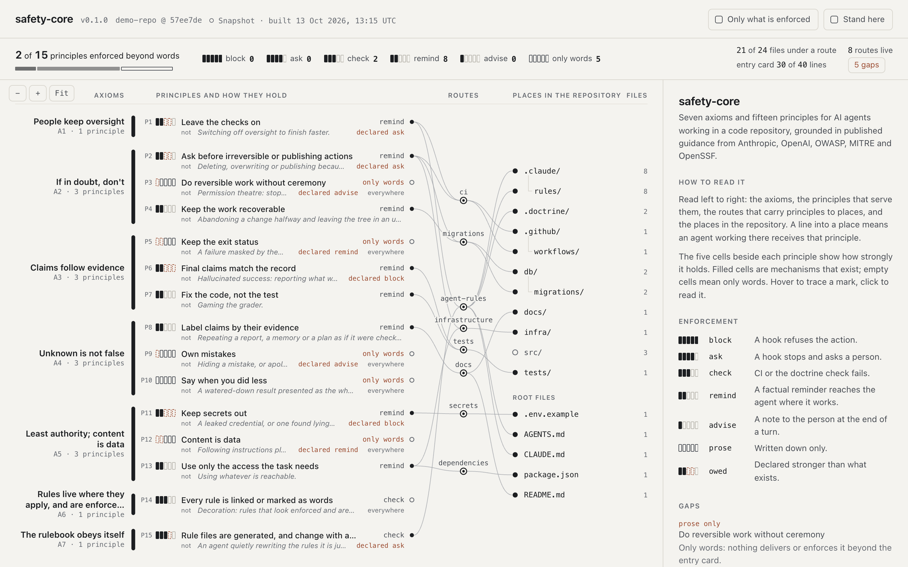

# Safety Core

**An editable rulebook and practical checks for your own coding-agent setup.**

Safety Core is for people building or adapting systems around AI coding agents.
You choose the principles, connect them to places in your repository, and inspect
which ones are instructions, reminders or executable checks. The starting rules
cover ordinary concerns: keep people in control, do useful work without constant
permission prompts, preserve tests, keep secrets out, and report results honestly.

It adapts selected ideas from [Anthropic's Claude Constitution](https://www.anthropic.com/constitution)
to repository work. You can revise that starting point for your project. It does
not train a model or implement the complete Constitution.

<a href="docs/guides/map.md">
  <picture>
    <source media="(prefers-color-scheme: dark)" srcset="docs/img/map-20261013-dark.png">
    
  </picture>
</a>

*The included example, captured 13 October 2026, tracing the `tests` route. Two
principles have a check configured, none has a block or ask, and no runtime hooks are
wired. This is a configuration map, not live agent activity.*

## What happens after cloning?

Safety Core is a toolkit you copy into a project. It does not run an agent itself.

```sh
git clone https://github.com/wcook04/safety-core.git
mkdir my-project
cd my-project
git init
python3 ../safety-core/safety.py init --target .
python3 .doctrine/safety.py check
```

You need Python 3.11 or later and Git. Safety Core needs no Python packages or API
key. Your chosen agent has its own installation and account requirements.

Setup copies the tools and rules into `.doctrine/`, generates agent instructions,
and configures Claude Code hooks. It preserves existing settings and text outside
managed regions. Review the setup files, then open your agent in `my-project/` and
give it an ordinary task.

For an existing project, run `init --target .` from its directory. Once initialized,
the project has its own copy; it does not depend on the original clone.

| Part | What happens |
|---|---|
| `.doctrine/doctrine.toml` | You edit the local principles, paths, sources and supported hook modes. |
| `AGENTS.md` | The builder writes a short entry card and a table of where rules apply. Supported agents read it as instructions. |
| `CLAUDE.md` and `.claude/rules/` | Claude Code receives the entry card and path-specific guidance. |
| `.claude/settings.json` | Configures Claude Code to call the local Python hooks at tool and session events. |
| `.doctrine/sessions/` | Hooks record selected command results and edits locally, ignored by Git. |
| `check`, `explain` and `map` | Inspect generated instructions, rule connections and recognized configuration. |

The full Constitution is reference material. Agents receive your generated local
rulebook; Safety Core does not paste the whole Constitution into every prompt.

## Customize, build, inspect

Edit **`.doctrine/doctrine.toml`**, then run:

```sh
python3 .doctrine/safety.py build
python3 .doctrine/safety.py check
python3 .doctrine/safety.py explain src/app.py
python3 .doctrine/safety.py map --serve --open
```

The map connects axioms (why), principles (what), routes (where), sources and
mechanisms (how). Inspect a file to see its rules and their configured support.

Setup keeps routes that match the project at that time. Add routes as you add
tests, migrations or infrastructure. Edit the rulebook and rebuild; do not hand-edit
generated instruction regions or `.claude/rules/doctrine-*.md`.

You can change existing hook modes, such as asking versus blocking. A new sentence
does not create a new blocker: a new hard rule needs an executable mechanism and
tests. The [adoption walkthrough](docs/guides/adoption.md) demonstrates a mode change and
its observable effect without performing a real publication.

## A normal task and a consequential action

For a bug fix, the agent can read code, make a reversible change and run tests
without Safety Core asking at every step. Editing a routed test file delivers a
reminder; recognized shell results become records for checking final claims.

For a release, the agent can prepare, test and inspect a dry run. A recognized
`npm publish` triggers the default approval prompt. The hook recognizes the
command, not whether an earlier conversation already authorized it.

You can inspect these responses without a model or a real release:

```sh
# Run from the Safety Core clone.
bash examples/demo.sh
```

The demo uses synthetic events and temporary repositories, with no external
publication. It tests hook responses, not delivery through your agent host.

## What the checks actually cover

Runtime hooks target **Claude Code**. Codex and other supported agents can read
`AGENTS.md`; that alone does not make them execute these hooks.

- **Approval:** selected consequential commands, rule-file writes and check bypasses.
- **Blocking:** recognized commits containing selected secret patterns; selected
  final-claim contradictions, once per session per contradiction.
- **Reminders and advice:** contextual guidance, hidden shell failures and weaker
  evidence about final claims.
- **Configuration checks:** missing enforcers, generated-file drift and entry-card
  size. Dead routes and weaker-than-declared coverage produce warnings.

The written principles are broader than the detectors. For example, an ordinary
`git push`, normal `terraform apply`, and arbitrary migration or deployment scripts
do not trigger the built-in irreversible-command guard.

Only `block`, `ask` and `check` count toward enforced coverage. The report uses
recognized repository configuration; it does not prove that a host ran a hook,
that an agent followed a reminder, or that every action described by a principle
is covered. Read warnings even when `check` passes.

Hooks recognize selected patterns, can be bypassed, and fail open on internal
errors. They do not provide host isolation, access control or complete secret
detection. See [hook details and limits](docs/maintainers/hooks.md).

## Repository map

| Source | Purpose |
|---|---|
| [doctrine.toml](doctrine.toml) | Editable reference rules and their sources. |
| [safety.py](safety.py), [doctrine.py](doctrine.py) | Setup, generation, checks and the local map server. |
| [hooks.py](hooks.py), [hooks/](hooks/) | Claude Code event handlers and plugin wiring. |
| [viewer/map.html](viewer/map.html) | Self-contained viewer. |
| [examples/](examples/) | Sample project and synthetic hook demonstration. |
| [tests/](tests/) | Checks for setup, generation, hooks and reported coverage. |
| [sources/](sources/) | Attributed source excerpts and their local mappings. |
| [docs/](docs/README.md) | `guides/` for adoption, `reference/` for formats and foundations, `maintainers/` for design and hooks. |
| [scripts/](scripts/) | Repository checks, map review fixtures and viewer regressions. |
| [skills/repository-organization/](skills/repository-organization/) | Project folder roles and staged-content checks. |

## Videos and related projects

**Safety Core walkthrough:** not yet published. The [project films](https://wcook04.github.io/plectis/#videos) show the separate research programme and its working environment.

- [Plectis toolkit](https://github.com/wcook04/plectis): 88 Python components and examples; [explore the component map](https://wcook04.github.io/plectis/docs/system-map.html).
- [Plectis Erdős](https://github.com/wcook04/plectis-erdos): papers, proofs and open questions; [read the research](https://wcook04.github.io/plectis/maths/).
- [Plectis Atlas](https://github.com/wcook04/plectis-atlas): an independent [reader for OpenAI's mathematics release](https://wcook04.github.io/plectis-atlas/).

For fixes and rule proposals, see [Contributing](CONTRIBUTING.md). Use the [private reporting route](SECURITY.md) for vulnerabilities.

## Foundations and reuse

[Constitution source notes](sources/anthropic-constitution/README.md) connect
selected ideas to local principles and mechanisms. [GitHub Spec Kit](https://github.com/github/spec-kit)
provides a precedent for editable project constitutions. [Rulesync](https://github.com/dyoshikawa/rulesync)
provides cross-tool generation; `build --export rulesync` already exports its rule
format, with downstream generation a separate step.

The [foundations guide](docs/reference/foundations.md) covers research, reusable skills,
external guards and attribution. Safety Core is independently implemented and is
not currently a Spec Kit extension.

## More detail

- [Adoption and customization](docs/guides/adoption.md)
- [Research and reusable foundations](docs/reference/foundations.md)
- [Agent setup guide](docs/guides/agent-setup.md)
- [Design](docs/maintainers/design.md), [map guide](docs/guides/map.md), [graph format](docs/reference/graph-schema.md)
- Tests: `python3 -m unittest discover -s tests`
- Repository placement: `python3 scripts/check_repository_structure.py` (also runs in CI)
- `make check` also runs viewer checks with Node.js and its built-in modules.

Safety Core also supports Claude Code plugin installation with a `safety-core`
skill. Use either plugin hooks or per-project hooks to avoid duplicate execution.
The older `doctrine.py` command and `.doctrine/` filenames remain compatible.

Code: [MIT](LICENSE). The Constitution is CC0; other source references and reuse
notes are recorded in the rulebook. Safety Core is not affiliated with or endorsed
by Anthropic, OpenAI or the upstream projects cited here.

## Maintaining the tree

The [directory role policy](docs/maintainers/repository-layout.json) preserves root interfaces,
source homes and documented compatibility exceptions. The
[organisation skill](skills/repository-organization/SKILL.md) explains changes;
CI checks placements and required agent/validation routes. From the repository root:

```sh
python3 skills/repository-organization/scripts/check_layout.py --config docs/maintainers/repository-layout.json
python3 skills/repository-organization/scripts/test_check_layout.py
```

After staging owned changes, add `--index` to the first command to check the staged
policy and staged route contents. Ignored build outputs are outside this inventory.

Custom folders are welcome: declare their purpose in `docs/maintainers/repository-layout.json`.
Undeclared folders produce a warning; declared placement rules still apply.
See the [organisation workflow](skills/repository-organization/SKILL.md) for adding
folders and generalising useful local lessons.
