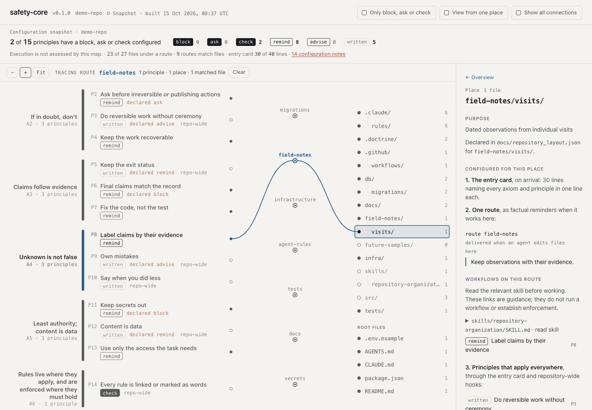
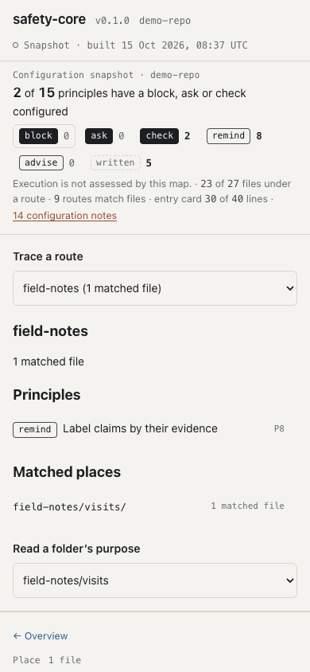

# Reading the map

The map shows your doctrine and your repository's configuration in one picture: which
principles a route associates with which parts of the code, what mechanism is configured
for each principle, and where the configuration differs from what the doctrine declares.
It shows configuration. It does not show what an agent did, unless you open a
[session trace](#session-traces) of what the hooks recorded.

<picture>
  <source media="(prefers-color-scheme: dark)" srcset="../img/map-20261015-dark.png">
  
</picture>

*Synthetic demo captured 15 October 2026 with one native zoom step. This shows
configured guidance; execution is not assessed.*

## Opening it

- `doctrine.py map --serve` runs the map on your computer. It redraws each time you
  save doctrine.toml or move files, and keeps your selection, zoom and position.
- `doctrine.py map --out doctrine-map.html` writes a single file with the graph inside.
  It opens from disk with no network access.
- If you serve the checkout and open `viewer/map.html` with no graph, it shows the sample in
  `examples/graph.sample.json`. The header then says "Sample data".

## The four columns

Read the map from left to right.

1. **Axioms.** The root commitments, at most seven. Each one is a bar that spans the
   principles serving it.
2. **Principles.** The working rules, each with its full title and, beneath it, the
   configured mechanism and any difference from the declared one.
3. **Routes.** A route associates principles with paths.
4. **Places.** The directories at depth one and two, plus root files that a route
   matches, listed as a file tree. The count is the files inside each place, so a
   folder and its subfolder can show the same files; do not add rows together.
   Route details show matched-file counts. A redundant parent link is omitted only
   when all of its matched files are represented by its children.

## Tracing one route

The map draws the connections of one route at a time. On opening, it traces a populated
route, chosen by principle count, then the fewest representative places, then id, so the same graph always opens the same way; add
`#route=tests` to the address to choose one. The bar above the map names the traced
route and how many principles, places and matched files it has.

- **Click a route** to trace it. Lines run in from the principles it carries and out to
  the places it matches. Hovering over a route previews its connections.
- **Click a principle or place** to read it. This does not expand the drawing into its
  other routes; the side panel lists them, and each one can be traced.
- **Clear** removes the trace. **Show all connections** draws every route at once, for
  checking the whole topology.

A principle that no route carries has a hollow end and the label "repo-wide". It
applies through the entry card, and through a repository-wide check where one is
configured.

## Session traces

A session trace draws one Claude Code session over the same map: the files it read and
edited, the routes those files fall under, and what the hooks said and when. Make one from
a session folder, then open it:

```sh
python3 .doctrine/safety.py trace .doctrine/sessions/<session id> --out trace.json
python3 .doctrine/safety.py map --trace trace.json --out trace-map.html --open
```

`map --serve --trace trace.json --open` does the same on the live map. From this checkout,
**Recorded example** in the bar above the map (or `viewer/map.html?trace=../docs/reference/agent-runs-20261018-trace-hook.json`
when the checkout is served, for example with `python3 -m http.server`) opens a real Claude
Haiku run: the pre-commit test fails, the agent retries `git commit` with an invented
`TALLY_RATES_URL`, and the check that asks stops it. **Open a session trace** reads any
trace file.

With a trace open, touched places are ringed and say "read", "edited" or "in a command";
each touched route says whether its reminder went out ("reminder at step 5", or "no
reminder sent" when, for example, the route delivers on edits and the file was only read);
and principles carry what the hooks did with them, such as "asked a person at step 6" or
"told the agent at step 4". A place with no route shows that only the entry card applied
there. The side panel lists the steps in order: select one, or use Previous, Next and Play,
to light only that step's places, routes and principles and read the text the hook
returned. Escape returns to the whole session; **Back to the plain map** leaves the trace.

The trace shows what the hooks recorded: commands and exit codes, reads and edits, and each
ask, deny, block or note. It does not show what the model read in its instructions or why it
chose an action, and "no record that it ran" means only that no receipt exists for that
call. The trace carries the graph of the configuration when it was made, which the map
draws while the trace is open. The format is in [trace-schema.md](../reference/trace-schema.md).

## On a phone

Below 600 pixels, a route selector and readable lists replace the small drawing.
Choose a route to see its full principle titles, configured mechanisms and matched
places. Tap a principle or place to read its details below. Routes with no matching
files remain selectable and explain the empty result. Wider screens retain the map.

## Configured mechanisms

Each principle shows one label for the mechanism the repository configuration provides.
The labels are categories, not points on a score:

| Label | Meaning |
|---|---|
| block | A hook refuses the action. |
| ask | A hook stops and asks a person. |
| check | CI or the doctrine check fails. |
| remind | A factual reminder reaches the agent where it works. |
| advise | A note to the person at the end of a turn. |
| written | Written down only. |

Block, ask and check are drawn filled, remind and advise outlined, and written dashed.
When the doctrine declares a different mechanism from the one configured, the row adds
"declared ask" (for example) in a muted warm colour. The panel then says
"Configuration differs". Changing a rule's wording does not add a mechanism; a hook or
check has to be configured for the label to change.

## Configuration notes

The side panel's overview lists three kinds of note, kept apart:

- **Declared and configured differ:** the doctrine names a stronger mechanism than the
  repository provides.
- **Wiring:** a named enforcer that is missing, a route that matches no file (shown in
  place as "0 matched files"), a sensitive place with no route, a stale generated file
  or an entry card over budget.
- **Written guidance only:** principles delivered by the entry card alone. That can be
  the right choice for a judgment call that no hook can check.

## The strip across the top

The strip names the snapshot and reads "N of M principles have a block, ask or check
configured", then gives the count for each mechanism, zeros included. Hover over a
mechanism to pick out its principles. The line beneath says that execution is not
assessed, and gives the files under a route, the routes that match files, and the
length of the entry card against its budget.

## The side panel

- A **route** shows its paths, how many files it matched, when it is delivered, the
  principles it carries with their own mechanisms, its reminder and the places it
  matches.
- A **principle** shows its one-line rule, then the configured and declared
  mechanisms, where it applies, and that execution is not assessed. Below that come
  what its mechanism does not establish, the failure it rejects, its sources (cited
  directly, then those inherited through its axioms) and the mechanisms it names.
- An **axiom** shows its plain reading, its clause, what it rejects, the principles
  serving it and its sources.
- A **place** lists what the configuration associates with it: the entry card, each
  route's reminder and principles, then the repository-wide principles.

**Only block, ask or check** fades every principle configured as a reminder, advice or
written guidance. **View from one place** picks a place and fades everything the
configuration does not associate with it. **Zoom** with the buttons, by pinching on a
trackpad, or with ctrl or cmd and the scroll wheel; drag to pan; "Fit" or the 0 key
resets the view.

## Keyboard

Tab moves into the map. The arrow keys then move within a column (up and down) and
between columns (left and right). Enter or Space opens the focused mark, and on a route
traces it. Escape returns the panel to the overview, and a second press leaves View from
one place. The + and - keys zoom.

## Layout

The layout is computed from the ids and the paths alone, with no simulation, so the same
doctrine always gives the same picture. Principles are grouped under their first axiom
in id order, and each row is sized to its wrapped title. Places are sorted by path.
Routes are ordered by the rows they join and spread evenly down the principle column,
so each label has its own space; selection never moves them. When the doctrine changes,
marks glide to their new rows, new marks fade in and removed ones fade out.

## Review captures

[Capture provenance](../maintainers/map-captures.json) records the source components,
fixture, native view state and artifact hashes. Compare relevant local viewer
branches before selecting a source; a cached PNG or clean main alone is not enough.

`python3 scripts/build_map_examples.py --out /path/to/review` builds standalone
snapshots from the included demo without changing it. `purposes.html` adds a
synthetic `field-notes/visits/` folder, declared directory purposes and a routed
repository-organization skill. Open it with `#route=field-notes`, select the
`visits` folder, and use one native zoom step to reproduce the desktop view above
at 1440 by 1000. The light and dark variants use the viewer’s existing themes.

The README opens with the same fixture’s full overview at 1440 by 1000. Use
**Clear**, **Show all connections**, then **Fit** to include all seven axioms,
fifteen principles and repository places. The route and purpose view above is a
closer look at one connection. Both views show configuration, not agent execution.

The phone view uses the same fixture at 390 by 844:

<picture>
  <source media="(prefers-color-scheme: dark)" srcset="../img/map-phone-20261015-dark.png">
  
</picture>

`empty.html#route=unused` demonstrates a route with no matching files. That
snapshot adds only the synthetic `unused/**` route. Run
`node scripts/test_map_model.js` for membership, old-snapshot, purpose and skill
rendering checks.

## For the engine

`viewer/map.html` is one self-contained file: the CSS and JavaScript are inline and it makes no
external requests. It reads only `doctrine-map/graph@1` (see
[GRAPH_SCHEMA.md](../reference/graph-schema.md)) and loads it in this order:

1. JSON inside `<script id="doctrine-graph" type="application/json"></script>`. To
   build a static map, replace that empty element with one holding the graph. Escape
   `</` as `<\/` inside the JSON.
2. `./graph.json`, fetched from the server. When it loads, the map also listens on
   `./events` for server-sent events and fetches the graph again on each message.
3. `./examples/graph.sample.json` or `../examples/graph.sample.json` in a source checkout.

## Coverage boundary

Only `block`, `ask` and `check` count as enforced. Reminders and advice remain visible
but do not enter that total. Hook credit requires repository event wiring and respects
mode overrides; it is a configuration report, not proof of execution in an agent host.

## Give folders a purpose and route their workflows

People can add folders for any purpose that suits their project. The map reads
`docs/repository_layout.json` when present, then
`docs/maintainers/repository-layout.json`; set `layout_policy` in the doctrine's
`[doctrine]` table to use another existing policy, such as Plectis's
`docs/maintainers/repository-layout.json`. A configured policy must exist and be
valid. Projects without a policy retain their current map. This checkout uses
`docs/maintainers/repository-layout.json`, with guide links to the maintained
documentation owners.

For example, create `field-notes/visit-01.md` and add this entry under the existing
policy's `directories` object:

```json
"field-notes": {"purpose": "Instrument observations and supporting material"}
```

The project chooses `undeclared_directories: "warn"` or `"error"`. Warning mode
allows ordinary additions while showing that their purpose is undeclared; it does
not disable existing placement checks. Version `repository_layout@2` also accepts
nested declarations. Ancestor constraints still apply. An optional `guide` names
an existing owner document. Folder declarations need no new approval ceremony.

The place panel shows the purpose, where it was declared, the guide and applicable
rule routes. Undeclared and declared-with-no-visible-files states remain distinct.
Both phone and desktop panels provide this information. The phone’s place selector
also opens folders with no matching route, including declared-only folders. Explicitly declared deep
folders appear without expanding every directory in the repository.

To attach an existing workflow, add a reference to a relevant `[[route]]` in
`doctrine.toml` (or `.doctrine/doctrine.toml` in an adopted project):

```toml
[[route]]
id = "field-notes"
paths = ["field-notes/**"]
principles = ["P8"]
reminder = "Keep observations and their evidence together."
skills = [{ path = "skills/repository-organization/SKILL.md", when = "Adding folders or generalising a local organisation lesson" }]
```

The path must name a local skill. Use the project's existing rule routes to select
paths and principles; folder creation does not require inventing a new safety rule.
Run `python3 doctrine.py build` and `python3 doctrine.py explain field-notes/visit-01.md`
(use `.doctrine/doctrine.py` in an adopted project). The route's skill appears in
explain output, generated agent guidance and hook reminders. In the map, select the
route or a matched place and expand the skill to read it, including offline. These
are workflow instructions, not enforcement or evidence of execution.

`init` retains only reference-skill associations whose files exist in the adopting
project. It does not install the author's folder tree or overwrite local skills.
The live map refreshes when its policy or referenced skills change. Save local
lessons in the local skill, generalise evidenced reusable rules through its existing
upstream owner, and rebuild generated views rather than editing them.

The review builder also emits `purposes.html#route=field-notes`, with a custom
folder, nested purpose, declared-only folder and routed organisation skill. Refresh
the viewer's fallback sample from that fixture with
`python3 scripts/build_map_examples.py --out /tmp/safety-map-review --refresh-sample`.
The fixture is assembled from the demo and the canonical local skill; generated
sample JSON is never edited by hand.
